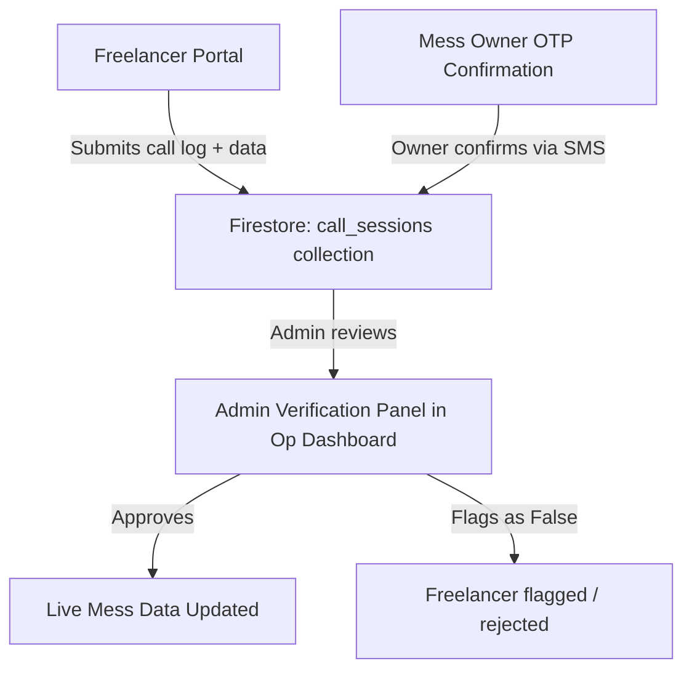

# 📞 Freelancer Call Management System — Solution Plan

> **Problem**: Freelancers need to call mess owners monthly to update seat availability, but cannot be given full Operational Dashboard access (risk of deletion). Also need to verify that calls were actually made and data entered is not falsified.

---

## 🧩 Overview: Two New Systems



---

## 🔵 System 1: Freelancer-Only Portal (`/freelancer`)

A **dedicated, locked-down web page** separate from the Operational Dashboard. Freelancers get unique login credentials that **only** open this portal — no access to any other route.

### What a Freelancer Can Do:
| Action | Allowed? |
|---|---|
| View assigned mess list for the month | ✅ |
| Click a phone number to initiate a call | ✅ |
| Log call outcome (call connected / not reachable) | ✅ |
| Fill in seat availability data submitted by owner | ✅ |
| View their own past submissions | ✅ |
| Edit / Delete mess data | ❌ |
| View other freelancers' data | ❌ |
| Access admin or operational dashboard | ❌ |

### Freelancer Portal UI Flow:

```
1. Login Page (/freelancer/login)
      ↓
2. My Assigned Messes (Today's call list, filtered by their assignment)
      ↓
3. Per Mess — Call Card:
   [📞 Call Owner] button → opens tel: link + timestamps call start
   After attempting → Modal opens:
      - Did owner receive the call? (Yes / No / Will Call Back)
      - If Yes → Enter seat availability form (rooms, vacancies per type)
      - Notes field (optional)
      - Upload call screenshot / proof (optional, from phone screenshot)
      - Submit
```

---

## 🔵 System 2: Call Verification Layer (Anti-Fraud)

### A. Phone Number Click Tracking (Timestamp Proof)
- When a freelancer clicks "Call Owner", record a `call_started_at` timestamp in Firestore **before** they can open the data form.
- The data submission form is **only unlocked** after the call button has been clicked.
- This prevents pre-filling data without dialing.

### B. Call Duration Enforcement (Soft Gate)
- After clicking call, a **timer starts** in the UI.
- The submission form is grayed out for a **minimum 30 seconds** (configurable).
- If the freelancer tries to submit too fast → form blocked with: *"Please spend at least 30s on the call before submitting."*
- This makes speed-running submissions much harder.

### C. Mess Owner OTP / Confirmation PIN (Strongest Verification)
> This is the most powerful anti-fraud mechanism.

**Flow:**
1. When a mess owner picks up the call, the freelancer reads them a **4-digit Confirmation PIN** generated uniquely for that mess + that month.
2. The PIN is shown to the freelancer on screen.
3. Owner then **goes to a simple URL** on their phone (e.g., `messkhojo.com/confirm?id=XYZ`) or **receives a WhatsApp/SMS** with a confirmation button.
4. Owner clicks confirm → submission is **owner-verified**.

> This also helps train mess owners to self-update in the future!

**Pin Generation Logic:**
```
PIN = hash(messId + month + year) → 4-digit numeric
```
Stored in Firestore, reset each month.

### D. Data Cross-Check by Admin (Op Dashboard "Review" Tab)
- All freelancer submissions land in a `call_sessions` Firestore collection with status `pending_review`.
- In the **Operational Dashboard**, a new **"Freelancer Submissions" tab** shows:
  - Mess name, freelancer who called, timestamp, call duration (from start/end gap)
  - Submitted seat data
  - Owner confirmation status (confirmed / unconfirmed)
  - Diff view: Previous data vs. New submitted data
  - **Approve** / **Flag as False** / **Request Re-call** buttons
- Only after **Admin Approves** does the live mess data actually update.

### E. Statistical Anomaly Detection (Smart Flag)
Auto-flag a submission for review if:
- Seats changed by more than **50% in one month** (suspicious)
- All rooms marked "Full" across many messes by same freelancer (suspicious)
- Submission happened within **<30 seconds** of call button click
- Same freelancer submitted **>N messes per hour** (too fast)

These flags appear as **yellow warning badges** in the admin review panel for manual inspection.

---

## 🗄️ Firestore Data Schema

### New Collection: `call_sessions`
```json
{
  "id": "auto",
  "messId": "mess_abc123",
  "messName": "Saraswati Mess",
  "freelancerId": "user_xyz",
  "freelancerEmail": "john@freelance.com",
  "assignedMonth": "2026-10",
  "callStartedAt": "Timestamp",
  "callEndedAt": "Timestamp",
  "callDurationSeconds": 145,
  "callOutcome": "connected | not_reachable | will_call_back",
  "ownerConfirmed": false,
  "ownerConfirmPin": "7483",
  "ownerConfirmedAt": null,
  "submittedData": {
    "totalVacancies": 12,
    "rooms": [
      { "roomType": "AC Room", "vacancy": 3, "totalSeats": 10 },
      { "roomType": "Standard Non-AC", "vacancy": 9, "totalSeats": 20 }
    ],
    "notes": "Owner said two new rooms added next month"
  },
  "previousData": { "totalVacancies": 8, "rooms": [...] },
  "status": "pending_review | approved | flagged | rejected",
  "reviewedBy": null,
  "reviewedAt": null,
  "flags": ["fast_submission", "large_vacancy_change"],
  "createdAt": "Timestamp"
}
```

### New Collection: `freelancers`
```json
{
  "id": "auto",
  "name": "Rahul Sharma",
  "email": "rahul@freelance.com",
  "phone": "9XXXXXXXXX",
  "assignedDistricts": ["balasore", "bhubaneswar"],
  "isActive": true,
  "totalCallsDone": 48,
  "totalApproved": 45,
  "totalFlagged": 3,
  "reliabilityScore": 93.75,
  "createdAt": "Timestamp"
}
```

### Mess document: New fields
```json
{
  "lastCallSessionId": "session_abc",
  "lastCallVerifiedAt": "Timestamp",
  "lastCallVerifiedBy": "rahul@freelance.com",
  "totalVacancies": 12,
  "vacancyLastUpdated": "Timestamp"
}
```

---

## 🔐 Auth & Role Structure

| Role | Firebase Custom Claim | Access |
|---|---|---|
| `admin` | `role: "admin"` | Full Op Dashboard |
| `operator` | `role: "operator"` | Operational Dashboard (no delete) |
| `freelancer` | `role: "freelancer"` | Freelancer Portal only |
| `mess_owner` | `role: "owner"` | Owner confirmation page only |

> Freelancers have a **separate login page** at `/freelancer/login` and are redirected to `/freelancer/dashboard` — any attempt to visit `/operational/*` or `/admin/*` is blocked by `ProtectedRoute`.

---

## 🏗️ Build Plan (Step-by-Step)

### Phase 1 — Freelancer Auth & Portal (Week 1)
- [ ] Add `freelancer` role to Firebase Auth custom claims
- [ ] Create `/freelancer/login` page (reuse `OperationalLogin` style)
- [ ] Create `ProtectedRoute` for `freelancer` role
- [ ] Create `/freelancer/dashboard` — basic assigned mess list

### Phase 2 — Call Logging Flow (Week 1-2)
- [ ] Build **Call Card** per mess with "Call Owner" button
- [ ] Implement `call_started_at` timestamp on button click
- [ ] Add 30-second timer gate before form unlocks
- [ ] Build data entry form (vacancies per room type)
- [ ] Write submission to `call_sessions` collection

### Phase 3 — Owner Confirmation (Week 2)
- [ ] Generate monthly PIN per mess
- [ ] Show PIN to freelancer on call card
- [ ] Create simple `/confirm` page for owners (mobile-friendly, no auth required)
- [ ] WhatsApp/SMS link generation for owners who can't type URLs

### Phase 4 — Admin Verification Panel (Week 2-3)
- [ ] New tab in Operational Dashboard: "Freelancer Submissions"
- [ ] Show submissions with diff view (previous vs new data)
- [ ] Auto-flag logic (fast submissions, large changes)
- [ ] Approve / Flag / Reject actions
- [ ] On Approve → update live mess data + set `vacancyLastUpdated`

### Phase 5 — Freelancer Performance Dashboard (Week 3)
- [ ] Freelancer's own stats: calls done, approved rate, flags
- [ ] Admin view: leaderboard of freelancer reliability scores
- [ ] Monthly report export (CSV)

---

## 🎯 Key Design Decisions

> [!IMPORTANT]
> **No direct write to `messes` collection from freelancer role.**
> All freelancer submissions go to `call_sessions`. Only the Admin/Operator can approve and trigger the actual mess update. This is enforced via Firestore Security Rules.

> [!NOTE]
> **Firestore Security Rule sketch:**
> ```
> match /call_sessions/{id} {
>   allow create: if request.auth.token.role == 'freelancer';
>   allow read, update: if request.auth.token.role in ['admin', 'operator'];
> }
> match /messes/{id} {
>   allow update: if request.auth.token.role in ['admin', 'operator'];
>   // freelancer role: NO write access to messes
> }
> ```

> [!TIP]
> **Reliability Score** is a powerful motivator. Display it prominently to freelancers — high scorers can be given more assignments and pay bonuses.

> [!WARNING]
> The Owner OTP/PIN system works best if mess owners are educated about it during onboarding. Add a small mention in the mess registration confirmation flow.

---

## 📊 Summary of Anti-Fraud Layers

| Layer | Prevents |
|---|---|
| Call button timestamp | Submitting without dialing |
| 30-second timer gate | Speed-running fake calls |
| Owner Confirmation PIN | Entirely fabricated calls |
| Admin approval before live update | Bad data going live |
| Statistical anomaly flags | Patterns of consistent falsification |
| Reliability score | Repeat offenders losing assignments |

