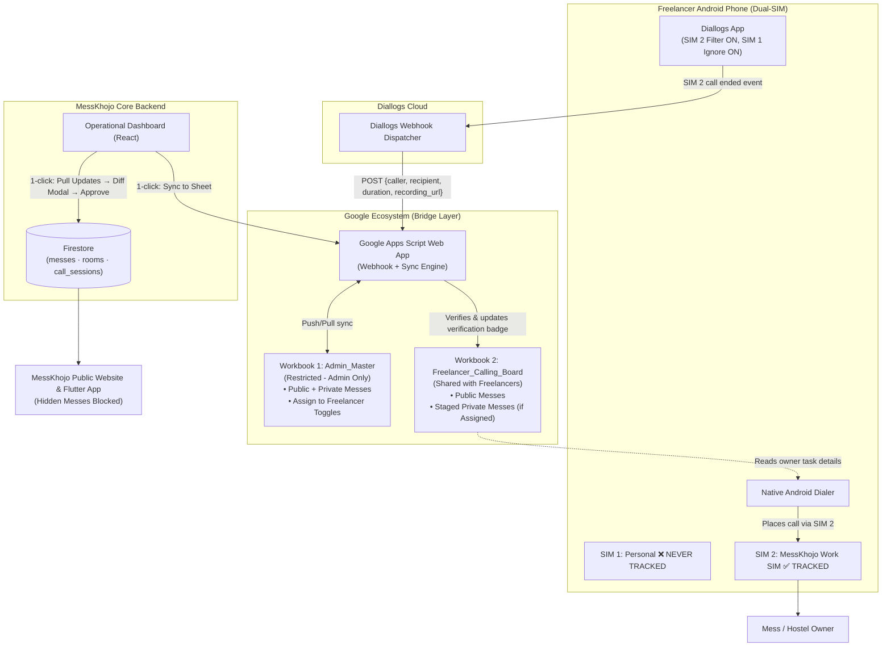
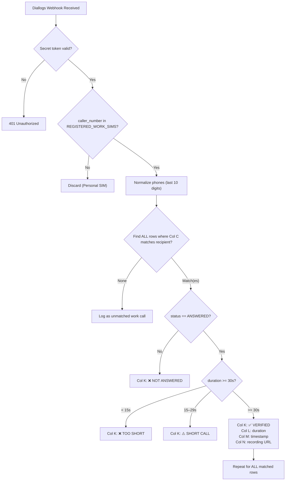

# 📋 MessKhojo — Final Implementation Plan
## Google Sheets Two-Way Sync + Diallogs Dual-SIM Call Verification + Private Mess Handling

> **Document Status**: Final (Updated with Private/Hidden Mess Strategy)  
> **Conversation ID**: `c7d21ae1-9a1f-436f-8da1-7227314ec900`  
> **Last Updated**: October 2026

---

## Table of Contents

1. [System Overview & Key Design Decisions](#1-system-overview--key-design-decisions)
2. [Full End-to-End Architecture](#2-full-end-to-end-architecture)
3. [Spreadsheet Architecture (Multi-Workbook)](#3-spreadsheet-architecture-multi-workbook)
4. [Column Schema: Admin Master Tab](#4-column-schema-admin-master-tab)
5. [Column Schema: Freelancer Calling Tab](#5-column-schema-freelancer-calling-tab)
6. [Handling Private & Hidden Messes](#6-handling-private--hidden-messes)
7. [Mess ID Strategy: Invisible Metadata + Task Codes](#7-mess-id-strategy-invisible-metadata--task-codes)
8. [Diallogs: Webhook-Only Integration (No API Key Needed)](#8-diallogs-webhook-only-integration-no-api-key-needed)
9. [Dual-SIM Android Setup & Privacy](#9-dual-sim-android-setup--privacy)
10. [Call Verification & Matching Engine](#10-call-verification--matching-engine)
11. [Google Apps Script — Complete Code](#11-google-apps-script--complete-code)
12. [Frontend: Sync Service](#12-frontend-sync-service)
13. [Frontend: Operational Dashboard UI](#13-frontend-operational-dashboard-ui)
14. [Firestore Schema Extensions](#14-firestore-schema-extensions)
15. [Security & Privacy Summary](#15-security--privacy-summary)
16. [Implementation Checklist](#16-implementation-checklist)

---

## 1. System Overview & Key Design Decisions

| Decision | Chosen Approach | Reason |
| :--- | :--- | :--- |
| **Call tracking tool** | Diallogs (Android app) | Tracks SIM-level calls with webhook output, no VoIP required |
| **Communication with Diallogs** | Webhook only (no API key) | Diallogs pushes call events to our Google Apps Script URL on call end. Zero cost, zero credential management. |
| **Is Diallogs linked to website?** | **No.** Only linked to Google Apps Script | Website is completely decoupled. Diallogs cannot touch Firestore directly. |
| **SIM tracking scope** | Work SIM (SIM 2) only | Freelancer personal SIM (SIM 1) is filtered at device level and server webhook level |
| **Mess ID exposure** | Hidden from freelancers | Friendly Task Code (`MK-101`) shown instead. Real Firestore ID stored as invisible Google Sheets `DeveloperMetadata` |
| **Duplicate-owner-phone problem** | Task Code + `DeveloperMetadata` as primary key | Multiple messes sharing one owner phone are each uniquely identified; one verified call marks all of them simultaneously |
| **Private / Hidden Messes** | Selective isolation & staging pipeline | Full control in Admin Master; strictly filtered in Freelancer Sheet (`Assign = Yes` only); zero risk of accidental unhiding |
| **Access control** | Two-Spreadsheet model | Freelancers get access only to their workbook, never see admin data or hidden listing status |
| **Sync direction: Website → Sheet** | Manual 1-click "Sync to Sheet" button in Operational Dashboard | Smart upsert: updates existing rows, appends only new messes, zero duplicates |
| **Sync direction: Sheet → Website** | Manual "Pull Updates from Sheet" button + Diff Review Modal | Human operator reviews all changes before any Firestore write |
| **Trigger model** | Fully manual | No automatic triggers, no scheduled jobs, no complexity |

---

## 2. Full End-to-End Architecture



---

## 3. Spreadsheet Architecture (Multi-Workbook)

Two completely separate Google Spreadsheets — never a single workbook with hidden tabs.

### Workbook 1: `MessKhojo_Admin_Master`
- **Shared with**: Operators and Admins only
- **Tabs**: `Messes_Master`, `Rooms_Master`, `Sync_Log`
- **Contents**: Complete database records including private, draft, unlisted messes, and admin toggle controls.

### Workbook 2: `MessKhojo_Freelancer_Calling_Board`
- **Shared with**: Freelancer Google accounts (Edit permission on input columns only)
- **Tabs**: `Calling_Tasks`, `How_To_Guide` (locked read-only instructions)
- **Contents**: Filtered task queue. Only active public messes and assigned private onboarding messes. No internal database IDs, no private status tags.

---

## 4. Column Schema: Admin Master Tab (`Messes_Master` — 34 Columns)

| Col | Header | Firestore Field | Notes |
| :---: | :--- | :--- | :--- |
| **A** | `Mess ID` | `mess.id` | Firestore document key |
| **B** | `Task Code` | Generated (`MK-{seq}`) | Human-friendly reference |
| **C** | `Mess Name` | `mess.name` | Property title |
| **D** | `Contact Number` | `mess.contact` | Primary phone |
| **E** | `District` | `mess.district` | e.g. Balasore |
| **F** | `City` | `mess.city` | e.g. Remuna |
| **G** | `Locality` | `mess.locality` | Neighborhood |
| **H** | `Address` | `mess.address` | Full address |
| **I** | `Gender / Type` | `mess.messType` | Boys / Girls / Both |
| **J** | `Food Facility` | `mess.foodAvailability` | Provided / Self |
| **K** | `Security Deposit` | `mess.securityDeposit` | In INR |
| **L** | `Rent Cycle` | `mess.rentCycle` | Monthly / Semester |
| **M** | `Single Bed Rent` | `room(1).price` | Single seater rent |
| **N** | `Single Bed Vacancy` | `room(1).availableCount` | Single seater vacancy |
| **O** | `Double Bed Rent` | `room(2).price` | Double seater rent |
| **P** | `Double Bed Vacancy` | `room(2).availableCount` | Double seater vacancy |
| **Q** | `Triple Bed Rent` | `room(3).price` | Triple seater rent |
| **R** | `Triple Bed Vacancy` | `room(3).availableCount` | Triple seater vacancy |
| **S** | `4 Bed Rent` | `room(4).price` | 4-seater rent |
| **T** | `4 Bed Vacancy` | `room(4).availableCount` | 4-seater vacancy |
| **U** | `5 Bed Rent` | `room(5).price` | 5-seater rent |
| **V** | `5 Bed Vacancy` | `room(5).availableCount` | 5-seater vacancy |
| **W** | `6 Bed Rent` | `room(6).price` | 6-seater rent |
| **X** | `6 Bed Vacancy` | `room(6).availableCount` | 6-seater vacancy |
| **Y** | `7 Bed Rent` | `room(7).price` | 7-seater rent |
| **Z** | `7 Bed Vacancy` | `room(7).availableCount` | 7-seater vacancy |
| **AA** | `8 Bed Rent` | `room(8).price` | 8-seater rent |
| **AB** | `8 Bed Vacancy` | `room(8).availableCount` | 8-seater vacancy |
| **AC** | `Total Vacancies` | Sum of all `room.availableCount` | Total available beds across all rooms |
| **AD** | **`Visibility Status`** | `mess.hidden` | **`Public`** vs **`Private`** |
| **AE** | **`Assign to Freelancer?`** | Sheet-level flag | **`Yes`** vs **`No`** (Controls push to Calling Board) |
| **AF** | `Hide Contact?` | `mess.hideContact` | `Yes` / `No` |
| **AG** | `Google Maps URL` | `mess.locationUrl` | Coordinates link |
| **AH** | `Last Synced At` | Auto-filled by script | Timestamp |

---

## 5. Column Schema: Freelancer Calling Tab (`Calling_Tasks` — 42 Columns)

**No Mess ID visible. No internal database fields. Full 1-to-8 seater room breakdown.**

### Zone 1: Website Benchmarks (Columns A to U: 21 Columns — 🔒 Locked)
* **A**: `Task Code` (e.g. `MK-101`)
* **B**: `Mess / Hostel Name`
* **C**: `Owner Phone`
* **D**: `Locality / City`
* **E**: `Property Type`
* **F & G**: `Single Rent (Curr)` & `Single Vac (Curr)`
* **H & I**: `Double Rent (Curr)` & `Double Vac (Curr)`
* **J & K**: `Triple Rent (Curr)` & `Triple Vac (Curr)`
* **L & M**: `4 Bed Rent (Curr)` & `4 Bed Vac (Curr)`
* **N & O**: `5 Bed Rent (Curr)` & `5 Bed Vac (Curr)`
* **P & Q**: `6 Bed Rent (Curr)` & `6 Bed Vac (Curr)`
* **R & S**: `7 Bed Rent (Curr)` & `7 Bed Vac (Curr)`
* **T & U**: `8 Bed Rent (Curr)` & `8 Bed Vac (Curr)`

### Zone 2: Freelancer Input (Columns V to AL: 17 Columns — ✍️ Editable)
* **V & W**: `Single Rent (New)` & `Single Vac (New)`
* **X & Y**: `Double Rent (New)` & `Double Vac (New)`
* **Z & AA**: `Triple Rent (New)` & `Triple Vac (New)`
* **AB & AC**: `4 Bed Rent (New)` & `4 Bed Vac (New)`
* **AD & AE**: `5 Bed Rent (New)` & `5 Bed Vac (New)`
* **AF & AG**: `6 Bed Rent (New)` & `6 Bed Vac (New)`
* **AH & AI**: `7 Bed Rent (New)` & `7 Bed Vac (New)`
* **AJ & AK**: `8 Bed Rent (New)` & `8 Bed Vac (New)`
* **AL**: `Notes / Remarks` (Discounts, terms, owner availability)

### Zone 3: Diallogs Call Tracking (Columns AM to AP: 4 Columns — 🤖 Auto-Filled)
* **AM**: `Call Verification` (`✅ VERIFIED` / `⚠️ SHORT` / `❌ NOT ANSWERED`)
* **AN**: `Call Duration` (e.g. `1m 45s`)
* **AO**: `Call Time` (e.g. `08-Oct 04:30 PM`)
* **AP**: `Recording` (Playable audio link)

> **Protected Ranges in Calling Sheet**:
> * Columns **A through U** (1–21) and **AM through AP** (39–42) are locked to Admins.
> * Columns **V through AL** (22–38) are open for Freelancer edits.

---

## 6. Handling Private & Hidden Messes

### The Concept in MessKhojo
In the MessKhojo ecosystem, a mess marked as `hidden: true`:
1. Does not appear on the website homepage, search, filters, or city listings (`CityPage.jsx`).
2. Does not appear on the map view (`CityExplorerPage.jsx`).
3. Shows a *"Listing Private"* placeholder screen if visited directly via URL (`MessDetails.jsx`).
4. Can only be viewed and edited by authorized operators in the Operational Dashboard.

### Common Scenarios for Private Messes
* **Scenario A — New Unverified Listing (Onboarding Queue)**: Newly registered messes need call verification for rent and seats before going public.
* **Scenario B — Seasonal Off-Market**: Temporarily full or undergoing renovations.
* **Scenario C — Delisted / Closed / Policy Violation**: Permanently off-market.

### How Each Scenario is Handled

| Scenario | Visibility in Admin Master | `Assign to Freelancers?` | Appears in Calling Board? | What Freelancer Sees | What Happens on Sync Back |
| :--- | :---: | :---: | :---: | :--- | :--- |
| **Public Active Mess** | `Public` | `Yes` (Default) | ✅ **Yes** | Standard Task | Rent & vacancy updated on live website |
| **New Private Onboarding** | `Private` | `Yes` (Explicit) | ✅ **Yes** | Standard Task (no "Private" label) | Data updated in Firestore; **remains Private** until Admin unhides |
| **Delisted / Inactive** | `Private` | `No` (Default) | ❌ **No (Excluded)** | Not exported | Untouched |

### Sync Guardrails for Private Messes
1. **Freelancer Isolation**: Freelancers never see the `Visibility Status` or `Assign to Freelancer` columns. To the freelancer, every task looks identical.
2. **Immutability of Visibility from Freelancer Sheet**: When pulling updates from the Freelancer Sheet, the sync script only writes `rent`, `vacancies`, and `notes`. It **never** alters `mess.hidden`.
3. **Diff Modal Visibility Warning**: If an operator changes `Visibility Status` from `Private` to `Public` in the Admin Master Sheet, the Diff Review Modal displays an amber warning banner:
   ```
   ⚠️ VISIBILITY CHANGE DETECTED:
   "Green Valley Boys Hostel (MK-105)" will be switched from PRIVATE to PUBLIC (Live on Website).
   ```

---

## 7. Mess ID Strategy: Invisible Metadata + Task Codes

### The Problem
- Multiple messes often share the same owner phone number (e.g., owner runs a Boys Hostel and a Girls Hostel on one contact).
- Raw Firestore IDs (`mess_0a9b8c...`) must never be exposed to freelancers.

### The Solution
1. **Task Code** shown in Column A: `MK-101`, `MK-102`, etc.
2. **Real Firestore `mess.id`** stored as invisible `DeveloperMetadata` on the row — zero cell space, completely invisible to sheet users.

```javascript
// Attach invisibly when generating the row:
sheet.getRange(rowNum, 1).addDeveloperMetadata('firestoreMessId', 'mess_abc123');

// Read back invisibly when syncing:
const meta = sheet.getRange(rowNum, 1).getDeveloperMetadata();
const messId = meta.find(m => m.getKey() === 'firestoreMessId')?.getValue();
```

### Multi-Mess, Same Phone: One Call Verifies All
```
Owner Phone: 9876543210
  ├── MK-101: Maa Tarini Boys Mess   → mess_abc123 (DeveloperMetadata)
  └── MK-102: Maa Tarini Girls Hostel → mess_xyz789 (DeveloperMetadata)

Diallogs Webhook fires for 9876543210 → duration 120s → ANSWERED

Result (both rows updated simultaneously in Google Sheet):
  ✅ MK-101: VERIFIED (2m 0s) — Recording: [link]
  ✅ MK-102: VERIFIED (2m 0s) — Recording: [link]

Freelancer fills updated rents & vacancies separately for each task.
```

---

## 8. Diallogs: Webhook-Only Integration (No API Key Needed)

Diallogs **pushes** call events directly to our Google Apps Script URL. We never poll Diallogs.

### Diallogs Webhook Configuration
1. In Diallogs Admin Panel → **Settings → Webhooks → Add Webhook**
2. Configure:
   - **URL**: `https://script.google.com/macros/s/DEPLOYMENT_ID/exec?secret=YOUR_SECRET`
   - **Event**: `call_ended`
   - **Method**: `POST`

### Incoming Webhook Payload
```json
{
  "event": "call_ended",
  "caller_number": "9876500001",
  "recipient_number": "9876543210",
  "status": "ANSWERED",
  "duration_seconds": 94,
  "started_at": "2026-10-08T06:12:15Z",
  "ended_at": "2026-10-08T06:13:49Z",
  "recording_url": "https://storage.diallogs.com/recordings/rec_98213.mp3",
  "sim_slot": "SIM_2"
}
```

### Webhook Security
Secret token is validated on every incoming payload. Unauthenticated requests are rejected immediately with `401 Unauthorized`.

---

## 9. Dual-SIM Android Setup & Privacy

### One-Time Device Setup (Per Freelancer)
1. Install **Diallogs** from Google Play Store.
2. Open Diallogs → Grant phone/call log permissions.
3. **Settings → SIM Card Tracking**:
   - ✅ **Track SIM 2** (MessKhojo Work SIM)
   - ❌ **Ignore SIM 1** (Freelancer Personal SIM)

### Daily Freelancer Workflow
1. Open `MessKhojo_Freelancer_Calling_Board` in Google Sheets.
2. Tap number in Column C → Android dialer opens → Select SIM 2.
3. Speak with owner, confirm room rents and vacancy count.
4. Return to sheet — `✅ VERIFIED` badge appears automatically within 5–10 seconds.
5. Fill in **Updated Rent (Col H)**, **Updated Vacancies (Col I)**, and **Remarks (Col J)**.
6. Move to next task.

---

## 10. Call Verification & Matching Engine



| Call Duration | Badge Assigned | Operator Action |
| :---: | :---: | :--- |
| `< 15s` | `❌ TOO SHORT` | Flagged; call rejected |
| `15–29s` | `⚠️ SHORT CALL` | Flagged for operator audio review |
| `>= 30s` | `✅ VERIFIED` | Automatically ready for sync approval |

---

## 11. Google Apps Script — Complete Code

**Location**: Apps Script editor inside the `MessKhojo_Freelancer_Calling_Board` (or dedicated container) spreadsheet.

```javascript
const CALLING_SHEET    = "Calling_Tasks";
const MASTER_SHEET     = "Messes_Master";
const MIN_VERIFIED_SEC = 30;

function normalizePhone(raw) {
  if (!raw) return '';
  const d = String(raw).replace(/\D/g, '');
  return d.length >= 10 ? d.slice(-10) : d;
}

function getWorkSIMs() {
  const raw = PropertiesService.getScriptProperties().getProperty('WORK_SIMS') || '';
  const simsMap = {};
  try {
    const parsed = JSON.parse(raw);
    if (Array.isArray(parsed)) {
      parsed.forEach(num => {
        const clean = normalizePhone(num);
        if (clean) simsMap[clean] = clean;
      });
    } else if (typeof parsed === 'object' && parsed !== null) {
      Object.keys(parsed).forEach(k => {
        const clean = normalizePhone(k);
        if (clean) simsMap[clean] = parsed[k];
      });
    } else if (typeof parsed === 'number') {
      const clean = normalizePhone(parsed);
      if (clean) simsMap[clean] = clean;
    }
  } catch (_) {}

  // Fallback for single numbers or comma-separated strings
  if (Object.keys(simsMap).length === 0 && raw) {
    String(raw).split(',').forEach(num => {
      const clean = normalizePhone(num.trim());
      if (clean) simsMap[clean] = clean;
    });
  }
  return simsMap;
}

function getSecret() {
  return PropertiesService.getScriptProperties().getProperty('WEBHOOK_SECRET');
}

// ── Main POST Router ──────────────────────────────────────────────────────────
function doPost(e) {
  try {
    if (e.parameter.secret !== getSecret()) {
      return ContentService.createTextOutput(JSON.stringify({ status: 'error', reason: 'Unauthorized' }))
        .setMimeType(ContentService.MimeType.JSON);
    }
    const payload = JSON.parse(e.postData.contents);
    if (payload.event === 'call_ended' || payload.caller_number) return handleDiallogsWebhook(payload);
    if (payload.action === 'sync_messes') return handleDashboardSync(payload);
    if (payload.action === 'export_calling_tasks') return handleExportCallingTasks(payload);
    return ContentService.createTextOutput(JSON.stringify({ status: 'ignored' }))
      .setMimeType(ContentService.MimeType.JSON);
  } catch (err) {
    return ContentService.createTextOutput(JSON.stringify({ status: 'error', message: err.message }))
      .setMimeType(ContentService.MimeType.JSON);
  }
}

// ── Diallogs Webhook Handler ──────────────────────────────────────────────────
function handleDiallogsWebhook(callData) {
  const caller    = normalizePhone(callData.caller_number || callData.agent_number);
  const recipient = normalizePhone(callData.recipient_number || callData.customer_number);
  const duration  = Number(callData.duration_seconds || callData.duration || 0);
  const status    = (callData.status || callData.disposition || '').toUpperCase();
  const recording = callData.recording_url || callData.audio_url || '';
  const ts        = new Date().toLocaleString('en-IN', { timeZone: 'Asia/Kolkata' });

  // 1. Work SIM verification
  if (!getWorkSIMs()[caller]) {
    return ContentService.createTextOutput(JSON.stringify({ status: 'ignored', reason: 'Not a Work SIM' }))
      .setMimeType(ContentService.MimeType.JSON);
  }

  // 2. Determine badge
  let badge = '❌ NOT ANSWERED';
  if (status === 'ANSWERED' || status === 'COMPLETED') {
    if (duration >= MIN_VERIFIED_SEC)  badge = '✅ VERIFIED';
    else if (duration >= 15)           badge = `⚠️ SHORT CALL (${duration}s)`;
    else                               badge = `❌ TOO SHORT (${duration}s)`;
  }
  const durStr = `${Math.floor(duration / 60)}m ${duration % 60}s`;

  // 3. Find ALL matching rows by owner phone (Col C = index 2)
  const sheet       = SpreadsheetApp.getActiveSpreadsheet().getSheetByName(CALLING_SHEET);
  const data        = sheet.getDataRange().getValues();
  const matchedRows = [];
  for (let i = 1; i < data.length; i++) {
    if (normalizePhone(data[i][2]) === recipient) matchedRows.push(i + 1);
  }
  if (matchedRows.length === 0) {
    return ContentService.createTextOutput(JSON.stringify({ status: 'unmatched', recipient }))
      .setMimeType(ContentService.MimeType.JSON);
  }

  // 4. Update ALL matched rows
  const lock = LockService.getScriptLock();
  lock.waitLock(10000);
  matchedRows.forEach(r => {
    sheet.getRange(r, 11).setValue(badge);    // Col K
    sheet.getRange(r, 12).setValue(durStr);   // Col L
    sheet.getRange(r, 13).setValue(ts);       // Col M
    if (recording) sheet.getRange(r, 14).setValue(recording); // Col N
  });
  lock.releaseLock();

  return ContentService.createTextOutput(JSON.stringify({
    status: 'success', updatedRows: matchedRows.length, verification: badge, duration: durStr
  })).setMimeType(ContentService.MimeType.JSON);
}

// ── Dashboard Sync Push Handler (Website → Admin Master Sheet) ───────────────
function handleDashboardSync(payload) {
  const lock = LockService.getScriptLock();
  lock.waitLock(15000);
  const sheet = SpreadsheetApp.getActiveSpreadsheet().getSheetByName(MASTER_SHEET);
  if (sheet.getLastRow() === 0) sheet.appendRow(payload.headers);

  const lastRow = sheet.getLastRow();
  const existingIds = {};
  if (lastRow > 1) {
    sheet.getRange(2, 1, lastRow - 1, 1).getValues().forEach(([id], idx) => {
      if (id) existingIds[String(id).trim()] = idx + 2;
    });
  }

  let inserted = 0, updated = 0;
  payload.rows.forEach(row => {
    const messId = String(row[0]).trim();
    if (!messId) return;
    if (existingIds[messId]) {
      sheet.getRange(existingIds[messId], 1, 1, row.length).setValues([row]);
      attachMessIdMetadata(sheet, existingIds[messId], messId);
      updated++;
    } else {
      sheet.appendRow(row);
      attachMessIdMetadata(sheet, sheet.getLastRow(), messId);
      inserted++;
    }
  });
  lock.releaseLock();

  return ContentService.createTextOutput(JSON.stringify({ status: 'success', inserted, updated }))
    .setMimeType(ContentService.MimeType.JSON);
}

// ── Export to Freelancer Sheet with Private Filter ────────────────────────────
function handleExportCallingTasks(payload) {
  const lock = LockService.getScriptLock();
  lock.waitLock(15000);
  const callingSheet = SpreadsheetApp.getActiveSpreadsheet().getSheetByName(CALLING_SHEET);
  
  // Headers if blank
  if (callingSheet.getLastRow() === 0) {
    callingSheet.appendRow([
      'Task Code', 'Mess / Hostel Name', 'Owner Phone', 'Locality / City',
      'Property Type', 'Current Rent', 'Current Vacancies', 'Updated Rent',
      'Updated Vacancies', 'Notes / Remarks', 'Call Verification',
      'Call Duration', 'Call Time', 'Recording'
    ]);
  }

  // Filter: Include Public messes OR Private messes where assignToFreelancer == true
  const tasksToExport = payload.tasks.filter(t => {
    const isPublic = !t.hidden;
    const isAssignedPrivate = !!t.hidden && t.assignToFreelancer === true;
    return isPublic || isAssignedPrivate;
  });

  // Smart Upsert into Calling Sheet using invisible metadata
  const existingMetaMap = {};
  const lastRow = callingSheet.getLastRow();
  for (let r = 2; r <= lastRow; r++) {
    const mId = getMessIdFromRow(callingSheet, r);
    if (mId) existingMetaMap[mId] = r;
  }

  let added = 0, refreshed = 0;
  tasksToExport.forEach(t => {
    const rowValues = [
      t.taskCode, t.name, t.contact, `${t.locality || ''}, ${t.city || ''}`,
      t.messType || 'General', t.currentRent || 'N/A', t.currentVacancies || '0',
      '', '', '', '', '', '', ''
    ];

    if (existingMetaMap[t.id]) {
      const rowIdx = existingMetaMap[t.id];
      // Refresh only reference columns A-G, protect freelancer inputs H, I, J
      callingSheet.getRange(rowIdx, 1, 1, 7).setValues([[
        t.taskCode, t.name, t.contact, `${t.locality || ''}, ${t.city || ''}`,
        t.messType || 'General', t.currentRent || 'N/A', t.currentVacancies || '0'
      ]]);
      refreshed++;
    } else {
      callingSheet.appendRow(rowValues);
      attachMessIdMetadata(callingSheet, callingSheet.getLastRow(), t.id);
      added++;
    }
  });

  lock.releaseLock();
  return ContentService.createTextOutput(JSON.stringify({ status: 'success', added, refreshed }))
    .setMimeType(ContentService.MimeType.JSON);
}

// ── GET Handler (Sheet → Dashboard Pull) ──────────────────────────────────────
function doGet(e) {
  if (e.parameter.secret !== getSecret()) {
    return ContentService.createTextOutput('401').setMimeType(ContentService.MimeType.TEXT);
  }
  const sheetName = e.parameter.target === 'master' ? MASTER_SHEET : CALLING_SHEET;
  const sheet = SpreadsheetApp.getActiveSpreadsheet().getSheetByName(sheetName);
  const data = sheet.getDataRange().getValues();
  if (data.length <= 1) {
    return ContentService.createTextOutput(JSON.stringify({ status: 'success', data: [] }))
      .setMimeType(ContentService.MimeType.JSON);
  }
  const headers = data[0];
  const result  = data.slice(1).map((row, rowIdx) => {
    const item = {};
    headers.forEach((h, ci) => { if (h) item[h.trim()] = row[ci]; });
    const messId = getMessIdFromRow(sheet, rowIdx + 2);
    if (messId) item['firestoreMessId'] = messId;
    return item;
  });
  return ContentService.createTextOutput(JSON.stringify({ status: 'success', data: result }))
    .setMimeType(ContentService.MimeType.JSON);
}

// ── DeveloperMetadata Helpers ─────────────────────────────────────────────────
function attachMessIdMetadata(sheet, rowNumber, messId) {
  try {
    const range = sheet.getRange(rowNumber, 1);
    const ex    = range.getDeveloperMetadata().find(m => m.getKey() === 'firestoreMessId');
    if (ex) ex.setValue(messId);
    else range.addDeveloperMetadata('firestoreMessId', messId);
  } catch (_) {}
}

function getMessIdFromRow(sheet, rowNumber) {
  try {
    const meta = sheet.getRange(rowNumber, 1).getDeveloperMetadata();
    return meta.find(m => m.getKey() === 'firestoreMessId')?.getValue() || null;
  } catch (_) { return null; }
}
```

---

## 12. Frontend: Sync Service

**Path**: `client/src/services/googleSheetSyncService.js`

### Methods:
1. `pushToGoogleSheet(messes, rooms)`:
   - Formats records for `Messes_Master` (including `Visibility Status` as `Public` or `Private`).
   - Automatically computes starting rent per seater and total vacancies.
   - Posts payload with `action: 'sync_messes'`.
2. `exportCallingTasks(messes, rooms)`:
   - Sends task queue with `action: 'export_calling_tasks'`.
   - Filters out `hidden === true && !assignToFreelancer`.
3. `pullFromGoogleSheet(target = 'calling')`:
   - Retrieves updated rents, vacancies, and verification statuses with invisible `firestoreMessId`.
4. `computeDiff(sheetRows, currentMesses)`:
   - Flags differences between sheet inputs and live Firestore fields.
   - Highlights any visibility toggles (`Private ↔ Public`).
5. `applyDiffToFirestore(approvedDiffs)`:
   - Atomically updates Firestore documents.

---

## 13. Frontend: Operational Dashboard UI

### `MessesTab.jsx` Controls
* **"⬆️ Sync to Admin Master"** → Updates master records in Admin sheet.
* **"📋 Push Tasks to Calling Board"** → Pushes active & assigned private messes to freelancers.
* **"⬇️ Pull Updates & Review"** → Fetches sheet edits and opens Diff Review Modal.

### Diff Review Modal with Visibility Badges
```
┌────────────────────────────────────────────────────────────────┐
│  Review Updates from Google Sheet                              │
├────────────────────────────────────────────────────────────────┤
│  Found updates for 2 messes:                                   │
│                                                                │
│  1. Maa Tarini Boys Mess (MK-101)  [Call Verified ✅]          │
│     • Single Bed Rent: ₹3,200  ➔  ₹3,500                       │
│     • Available Vacancies: 3 seats  ➔  1 seat                  │
│                                                                │
│  2. OM Shanti Hostel (MK-105)                                  │
│     ⚠️ VISIBILITY CHANGE: Private  ➔  Public (Goes Live!)      │
│     • Verified By: Rahul Sharma (Call: 1m 45s)                 │
├────────────────────────────────────────────────────────────────┤
│  [ Cancel ]                [ ✅ Confirm & Update Firestore ]   │
└────────────────────────────────────────────────────────────────┘
```

---

## 14. Firestore Schema Extensions

### `messes` Document
```json
{
  "taskCode": "MK-101",
  "hidden": false,
  "assignToFreelancer": true,
  "ownerCallStatus": "verified",
  "ownerCallStatusAt": "Timestamp",
  "ownerCallStatusBy": "Rahul Sharma",
  "lastCallDurationSeconds": 84,
  "lastCallRecordingUrl": "https://storage.diallogs.com/rec_98213.mp3",
  "vacancyLastUpdated": "Timestamp"
}
```

### `call_sessions` Collection (Audit Trail)
```json
{
  "id": "auto",
  "messId": "mess_abc123",
  "taskCode": "MK-101",
  "messName": "Maa Tarini Boys Mess",
  "freelancerName": "Rahul Sharma",
  "freelancerWorkSIM": "9876500001",
  "ownerPhone": "9876543210",
  "callStatus": "VERIFIED",
  "callDurationSeconds": 84,
  "recordingUrl": "https://storage.diallogs.com/...",
  "submittedData": { "updatedRent": 3500, "updatedVacancies": 1, "remarks": "..." },
  "previousData": { "rent": 3200, "vacancies": 3 },
  "approvedBy": "messkhojooperator@gmail.com",
  "approvedAt": "Timestamp"
}
```

---

## 15. Security & Privacy Summary

| Threat / Risk | Safeguard |
| :--- | :--- |
| **Private mess exposed prematurely** | Freelancers never see visibility columns. Freelancer sync cannot change `hidden` status. |
| **Personal SIM calls tracked** | Diallogs app filters by SIM slot on device; server drops non-work callers. |
| **Freelancer sees Mess ID** | Invisible `DeveloperMetadata` on row; only friendly `MK-xxx` Task Codes shown. |
| **Freelancer edits system columns** | Protected Ranges lock Columns A–G and K–N. |
| **Freelancer accesses admin data** | Completely separate Google workbooks. |
| **Spoofed Diallogs webhooks** | Secret token query parameter verified on every incoming request. |
| **Unreviewed updates going live** | Diff Review Modal requires explicit human operator confirmation. |
| **Diallogs accessing Firestore** | Decoupled architecture. Diallogs only connects to Google Apps Script. |

---

## 16. Implementation Checklist

### Phase 1: Spreadsheets Setup
- [ ] Create `MessKhojo_Admin_Master` workbook (Admins only) with `Messes_Master` headers.
- [ ] Create `MessKhojo_Freelancer_Calling_Board` workbook (Freelancers edit) with `Calling_Tasks` headers.
- [ ] Set Protected Ranges on `Calling_Tasks` (Lock A–G, K–N; Allow H, I, J).

### Phase 2: Google Apps Script Web App
- [ ] Paste updated `Code.gs` from Section 11 into Apps Script editor.
- [ ] Set Script Properties: `WEBHOOK_SECRET` and `WORK_SIMS`.
- [ ] Deploy Web App (Execute as: Me, Access: Anyone).

### Phase 3: Diallogs Setup
- [ ] Register Diallogs account, add Work SIM numbers as Agents.
- [ ] Configure Webhook to post to GAS Web App URL with `?secret=`.
- [ ] Configure freelancer Android devices (SIM 2 tracked, SIM 1 ignored).

### Phase 4: Frontend Development
- [ ] Add `.env` variables (`VITE_GOOGLE_SHEET_WEBHOOK_URL`, `VITE_GOOGLE_SHEET_SECRET`).
- [ ] Implement `client/src/services/googleSheetSyncService.js`.
- [ ] Add Sync buttons, Task Export button, and Diff Review Modal in [MessesTab.jsx](file:///d:/Full%20projects/.gemini/antigravity/scratch/mess-khojo/client/src/pages/OperationalDashboard/tabs/MessesTab.jsx).
- [ ] Connect Call Verification audit cards in [OwnerCallsTab.jsx](file:///d:/Full%20projects/.gemini/antigravity/scratch/mess-khojo/client/src/pages/OperationalDashboard/tabs/OwnerCallsTab.jsx).

### Phase 5: Verification & Quality Assurance
- [ ] **Test Push**: Sync messes to Admin Master → confirm `Public`/`Private` tags populated.
- [ ] **Test Filter**: Push calling tasks → verify that unassigned private messes are excluded.
- [ ] **Test Private Staging**: Assign private mess → verify freelancer receives task, calls owner, updates seats.
- [ ] **Test Pull & Approval**: Pull updates → verify mess remains `Private` after pull until operator unhides it.
- [ ] **Test Diallogs Call**: Place test call on Work SIM → verify automatic badge within 10 seconds.
- [ ] **Test SIM Privacy**: Place call on Personal SIM → verify zero logs captured in sheet.

---

## Reference File Paths

| Resource | Path |
| :--- | :--- |
| **This Document (Workspace)** | [google_sheets_sync_implementation_plan.md](file:///d:/Full%20projects/.gemini/google_sheets_sync_implementation_plan.md) |
| **This Document (Artifact)** | [google_sheets_sync_implementation_plan.md](file:///C:/Users/barma/.gemini/antigravity-ide/brain/c7d21ae1-9a1f-436f-8da1-7227314ec900/google_sheets_sync_implementation_plan.md) |
| **Operational Dashboard** | [OperationalDashboard.jsx](file:///d:/Full%20projects/.gemini/antigravity/scratch/mess-khojo/client/src/pages/OperationalDashboard.jsx) |
| **Messes Tab** | [MessesTab.jsx](file:///d:/Full%20projects/.gemini/antigravity/scratch/mess-khojo/client/src/pages/OperationalDashboard/tabs/MessesTab.jsx) |
| **Owner Calls Tab** | [OwnerCallsTab.jsx](file:///d:/Full%20projects/.gemini/antigravity/scratch/mess-khojo/client/src/pages/OperationalDashboard/tabs/OwnerCallsTab.jsx) |
| **Mess Details (Public Guard)** | [MessDetails.jsx](file:///d:/Full%20projects/.gemini/antigravity/scratch/mess-khojo/client/src/pages/MessDetails.jsx) |
| **City Page (Public Filter)** | [CityPage.jsx](file:///d:/Full%20projects/.gemini/antigravity/scratch/mess-khojo/client/src/pages/CityPage.jsx) |
| **Firestore Rules** | [firestore.rules](file:///d:/Full%20projects/.gemini/antigravity/scratch/mess-khojo/firestore.rules) |
| **Conversation ID** | `c7d21ae1-9a1f-436f-8da1-7227314ec900` |
